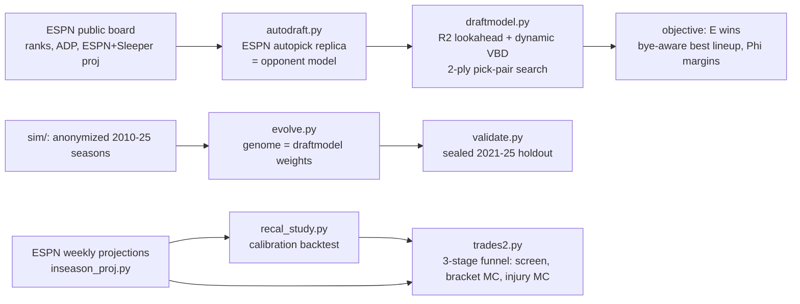
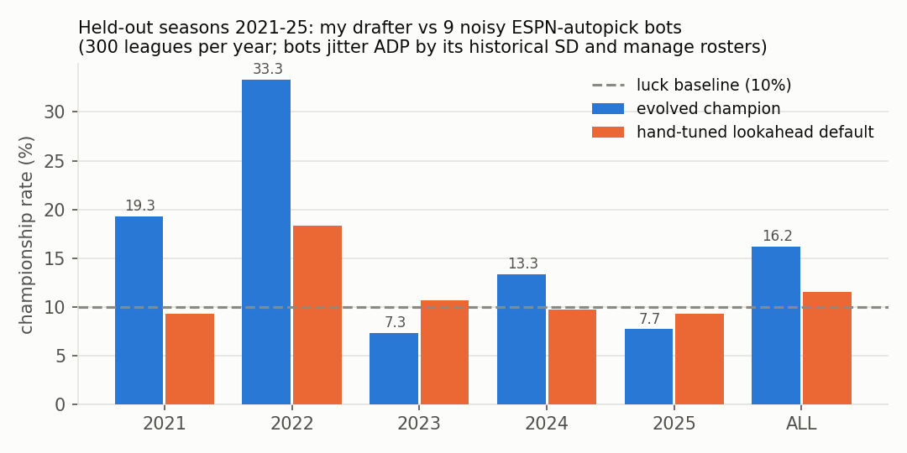
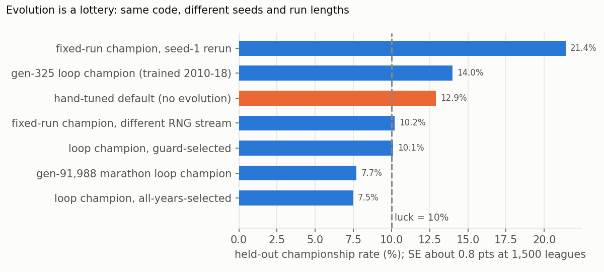
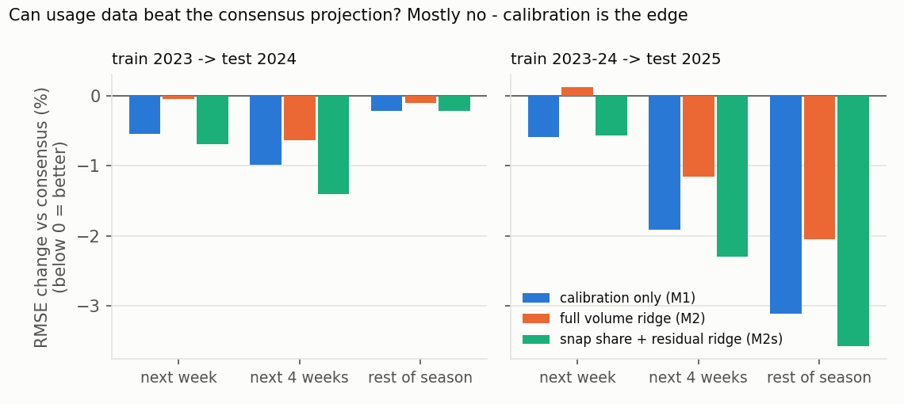

# fantasy-draft-optimizer

Lookahead drafting, season Monte Carlo and a calibration study for a 10-team ESPN fantasy football league: a small, fully specified decision-under-uncertainty problem (dynamic programming against a computable opponent model, paired Monte Carlo, out-of-sample validation) where I could measure how much edge the method really adds, and how much of it survives realistic noise.

## Key results

- **Lookahead beats autodraft on held-out seasons.** In a point-in-time backtest (policies see only that year's preseason ADP; 2021-25 never touched during training), the evolved lookahead drafter won **16.2% of titles vs a 10% luck baseline (+8.0 SE)** against 9 noisy, roster-managing ESPN-autopick bots, over 1,500 held-out leagues. Against deterministic autopick bots the same genome scored **21.4% (+14.7 SE)**. I re-ran the noisy-bot exam from the shipped code and got 16.2% exactly ([results/holdout_v2_seed42.txt](results/holdout_v2_seed42.txt)).
- **The edge is real but uneven across seasons.** By year it goes 19.3 / 33.3 / 7.3 / 13.3 / 7.7% (2021-25), so two of the five held-out seasons come in *below* luck. The hand-tuned lookahead model with no evolution gets 11.5% (+1.9 SE) against noisy bots and 12.9% (+3.8 SE) against clean ones: real, but small.
- **Evolution is a lottery, and I measured that directly.** The same settings with a different RNG stream gave a champion at 10.2% (luck). A 91,988-generation marathon run gave 7.7%, *below* luck. My rule since then: evolve several seeds, select on training years only, and give the holdout one look.
- **Out-projecting the consensus mostly fails.** Across 13,000 player-weeks (2023-25), adding trailing volume (targets, carries, red-zone looks, snaps) never beat the consensus weekly projection out of sample. What did work was *calibration*: shrinking projected gaps cut rest-of-season RMSE by **3.1% (t = 10.4)**, and adding snap share plus the running projection residual got it to **3.6%**. Almost all of that gain is at QB (RMSE 5.18 to 4.25). The effect is unstable, though: the QB calibration slope was 1.14 in 2024 and 0.62 in 2025.
- **Projection error dwarfs strategy edge.** The literature's lookahead gain is about 3-4% of roster value, or 2-4 starting-lineup points a week. Typical projection error is 30-70 points per player-season (mean absolute error, by position), so a single QB miss (~65 pts, about 4 pts a week) cancels it. That is why the models spend their effort on timing and price, not on out-projecting the market.
- **Trade engine: 558k packages per run, with depth priced properly.** It searches every 1-for-1 through 4-for-4 package against all nine opponents, then runs a 4,000-season bracket Monte Carlo and a 300-scenario injury Monte Carlo with common random numbers. It found that no 1-for-1 trade clears the acceptance bar, and it flipped three deals from "counterparty loses" to "fair" once injury sampling put a price on bench depth.

## Why this problem

An ESPN league where most teams autodraft is close to a perfect-information game. Autopick is deterministic given the board, so every opponent's future picks can be computed. That is the regime in which Fry, Lundberg & Ohlmann (2007) proved lookahead drafting dominates greedy (+2.9% roster value over ESPN-style need-filling, +7.5% over greedy-by-points; summarized in [docs/DRAFT_STRATEGY_RESEARCH.md](docs/DRAFT_STRATEGY_RESEARCH.md)). The questions I wanted to answer with my own simulation were how big that edge is, whether it survives real noise, and what is actually worth optimizing once you account for how noisy the inputs are. It is the same workflow as a trading-signal study: a baseline, a point-in-time backtest, a sealed holdout, costs (here: noise), and a check for overfitting the search itself.

## Method



**Opponent model.** [`src/autodraft.py`](src/autodraft.py) replicates ESPN autopick: it takes the highest-ranked available player that fills an open starting slot (FLEX included), stays under the position caps, and defers K/DST to the endgame. Replaying it forward gives the exact set of players who disappear before my next pick.

**Lookahead policy** ([`src/draftmodel.py`](src/draftmodel.py)). This follows Fry et al.'s restriction R2: at pick $t$ I only consider players who will *not* survive to my next pick,

$$\Omega_t = A_t \setminus A_{t+1},$$

because anyone who survives can be taken later at zero cost. Each candidate is scored by the value over the replacement level of the slot it would fill. That replacement level is a dynamic VBD baseline $b_p(t)$, recomputed after every pick from the league's remaining starter demand:

$$v(x) = \begin{cases} \mathrm{proj}_x - b_{p(x)}(t) & \text{open starter slot} \\ \mathrm{proj}_x - b_{\text{flex}}(t) & \text{FLEX fill} \\ \beta\,(\mathrm{proj}_x - b_{p(x)}(t)),\ \beta = 0.6 & \text{bench} \end{cases}$$

On the clock, the model searches this pick and my next pick together (the two picks either side of the snake turn), $\max_x \; v(x) + \max_{y \in A_{t'} \mid x} v(y)$, completes the draft with the greedy policy, and scores the final roster by expected head-to-head wins:

$$\mathbb{E}[W] = \sum_{w=1}^{14} \frac{1}{|O|}\sum_{o \in O} \Phi\!\left(\frac{\mu_{\text{me},w} - \mu_{o,w}}{\sigma}\right), \qquad \sigma = 35,$$

where $\mu_{t,w}$ is team $t$'s bye-aware best-lineup projection in week $w$. Pick trades are priced the same way: the whole draft is re-simulated under the swapped pick ownership (`--trades`).

**Backtest environment** ([`sim/`](sim/README.md)). Player names are replaced at ingestion with salted hashes. For season $Y$ a policy sees only that year's preseason ADP (with its SD and bye weeks) and rank-to-points curves fitted on seasons before $Y$. Actual weekly points are used only to score finished seasons. The "genome" is draftmodel's weight vector (flex split, bench β, baseline depth, lookahead weight, positional biases, reach penalty, K/DST timing, plus three roster-management genes). Evolution trains on 2010-2020, and [`validate.py`](sim/validate.py) grades on 2021-2025.

**In-season trade engine** ([`src/trades2.py`](src/trades2.py)). This uses per-week ESPN projections, the real 14-week schedule plus the standings already banked, and the league's 6-team bracket (top-2 byes, weeks 15-17). The search is a three-stage funnel:

| Stage | What | Scale |
|---|---|---|
| 1 | Deterministic $\Delta\mathbb{E}[W]$ on the real schedule, with $\Phi$ margins at $\sigma = 25\sqrt2$. Unbalanced trades are filled from free agents or cut down. | every 1-for-1 ... 4-for-4, ~62k packages per opponent, 0.6 ms each |
| 2 | Vectorized season plus bracket Monte Carlo, with common random numbers across candidates | top 300 × 4,000 seasons |
| 3 | Injury + persistent projection-error scenarios, with lineups re-optimized inside every scenario | top 40 × 300 scenarios (1,500 for finalists) |

Stage 3 injury model: a weekly hazard by position (RB 4.5%, WR/TE 3.5%, QB 2%), geometric spell lengths averaging 3 weeks, 15% of injuries season-ending, and a lognormal per-player projection error with SD 0.15-0.25. A counterparty is "acceptable" when its own lineup math doesn't lose (ΔW ≥ −0.02) and the crowd-value calculator it will check (FantasyCalc) doesn't show it losing more than 12%.

**Calibration** ([`src/recal_study.py`](src/recal_study.py), [docs/RECALIBRATION_STUDY.md](docs/RECALIBRATION_STUDY.md)). This is a per-position ridge regression on the consensus projection, EWMA snap share (half-life 3 weeks), the EWMA of (actual − projection), and games played. It is fitted on frozen historical Sleeper projections and tested out of sample by season, with week-level paired t-tests. Separately, the trade engine can shrink each weekly projection toward the positional starter mean, $\tilde{p} = m + b\,(p - m)$, using the published calibration slopes.

## Results



| Genome (held-out 2021-25) | vs deterministic autopick bots | vs noisy, managed bots |
|---|---|---|
| Evolved champion (fixed run, seed 1) | **21.4%** titles (+14.7 SE) | **16.2%** titles, 45.8% playoffs, 6.83 wins (+8.0 SE) |
| Hand-tuned lookahead default | 12.9% (+3.8 SE) | 11.5%, 38.8%, 6.47 (+1.9 SE) |
| Luck baseline | 10.0% | 10.0%, 40.0%, 6.50 |

When the bots get realistic ADP noise and manage their rosters, the title rate drops from 21.4% to 16.2%. The edge over luck shrinks from +11.4 to +6.2 points but stays at +8 SE, so most of it is drafting skill, not an exploit of how the bots behave. (The deterministic-bot column is from the draft-only v1 environment. Re-running it in the current managed environment gives 20.7%, +13.9 SE; see [results/holdout_cleanbots_seed42.txt](results/holdout_cleanbots_seed42.txt).)



On the pre-draft 2026 board with an illustrative keeper config (`examples/draft/league_config.json`) and deterministic opponents, [`src/draftmodel.py --pick-values`](results/draft_pick_values_demo.txt) projects **7.53 vs 6.75 expected wins (+0.78)** and **1,614 vs 1,556 season lineup points (+3.7%)** for the model against drafting on autopick from the same slot. That is the same order as Fry et al.'s +2.9%. It is an in-model projection graded by its own objective, not an outcome.



| Hypothesis (recalibration study) | Result |
|---|---|
| Trailing volume beats the consensus | **No.** The full volume ridge is at or behind the benchmark in every fold and horizon. |
| Consensus projections are over-dispersed | **Yes, and the gap grows with horizon:** −0.5% (next week), −1 to −1.9% (4 weeks), −3.1% (rest of season, t = 10.4) |
| Snap share + residual on top of calibration | **Yes, small:** best model in 7 of 8 cells (t = 3-9) |

**Trade lab** ([`sim/trade_lab.py`](sim/trade_lab.py)). This is an open-ended self-play experiment. Evolved value nets (129 weights) propose and accept 1-for-1 trades, with an AlphaZero-style gated incumbent. With rational owners it converged to the **no-trade theorem** (Milgrom-Stokey): the incumbent vs never-trading margin was −0.03 (SE 0.19). Once behaviorally biased owners were added (recency and anchoring), the incumbent beat never-trading by **+0.306 ± 0.054 on training years and +0.196 ± 0.054 on the 2021-25 holdout** (n = 5,000 paired leagues each). That is roughly a third to a half of a certified oracle's +0.63. The lesson: trade edge comes from counterparties' mispricing, not from trade mechanics.

## Validation & pitfalls caught

- **Point-in-time knowledge only.** Projection curves for season $Y$ are fitted on seasons before $Y$, in-season form uses earlier weeks only, and player identities are hashed, so no policy can memorize names.
- **Sealed holdout, with a budget.** Evolution and champion selection never see 2021-25. I logged every holdout look (eight gradings) and switched to "select on training years, then one holdout look for the winner". Replicating an already-graded genome is measurement. Grading a new one spends the exam.
- **Selection over noise.** The "guard best" genomes from the marathon loop were maxima over noise: population mean fitness stayed flat around 8.1 for 92k generations. I caught this because they graded *below* luck on the holdout.
- **Underpowered grading.** The first trade-net grading at n = 300 leagues read as "no skill" (+0.09 ± 0.23). The effect is about +0.2, which needs ~2,000+ paired leagues to resolve, so I regraded at n = 5,000 and it resolved at +3.6 SE on the holdout.
- **Common random numbers.** Trade candidates share one noise draw per (sim, team, week), so paired differences stay tight. Even so, stage-3 noise is about ±1% title odds at 1,500 scenarios, so I treat rankings within ±1% as ties.
- **Environment certification before training.** An oracle trader had to beat never-trading (+0.63, +2.7 SE) before I trusted the trade lab. That check exposed two modeling bugs that had kept trade volume near zero.
- **Model audit.** [docs/TRADE_MODEL_AUDIT.md](docs/TRADE_MODEL_AUDIT.md) documents six errors in my first trade model: flat preseason projections, the wrong playoff format, zero value on depth, unbalanced rosters, and more. Two of them flipped the sign of typical recommendations.

## Repo layout

```
src/
  autodraft.py       ESPN autopick replica (baseline + opponent model); loads league_config.json
  draftmodel.py      lookahead drafter: R2 + dynamic VBD + 2-ply pick pairs, E[wins] objective, pick trades
  turn.py            live-draft helper: validate/append picks, rerun the recommender
  fetch_board.py     ESPN public board + Sleeper season projections -> board_2026.json
  inseason_proj.py   ESPN public per-week projections -> weekly_proj_2026.json
  trades.py          v1 in-season trade grader (kept as the audited baseline; FantasyCalc helpers)
  trades2.py         v2 trade engine: 3-stage funnel, real schedule + 6-team bracket, injury MC
  waiver_scan.py     free-agent adds valued by injury-aware ΔE[wins]
  recal_study.py     can usage data beat consensus projections? backtest + 2026 recalibration
sim/                 anonymized historical backtest: env, genome, evolve, validate, trade lab (+ README)
  results*/          champion genomes and short histories from each run cited above
examples/            small fixtures to run the code (see Reproducing)
results/             holdout replication logs, draft-day demo output
figures/             README figures (scripts/make_figures.py)
docs/                literature review, recalibration study, trade-model audit
```

## Reproducing

```bash
pip install -r requirements.txt

# Draft model on a sample of the 2026 pre-draft ESPN board + an illustrative league_config.json
# (scripts read/write JSON in the cwd; LEAGUE_CONFIG=path overrides the config file)
cd examples/draft
python ../../src/autodraft.py              # what ESPN autopick would take
python ../../src/draftmodel.py             # 2-ply lookahead recommendation
python ../../src/draftmodel.py --pick-values
cd ../..

# In-season engine on a SYNTHETIC 10-team league (seeded simulated draft, round-robin schedule)
cd examples/inseason
python ../../src/trades2.py --no-search    # standings odds + roster audit (< 1 s)
python ../../src/trades2.py --quick --opp t5
python ../../src/waiver_scan.py --sims 100
cd ../..

# Historical backtest (downloads public data, ~2 min; then ~3 min per validation)
python sim/fetch_history.py
python sim/validate.py --leagues 300 --seed 42      # reproduces results/holdout_v2_seed42.txt
# retraining writes sim/results/champion.json - follow the multi-seed protocol in sim/README.md

python scripts/make_figures.py
```

**Data.** Nothing licensed or private is redistributed here.
- `examples/draft/board_2026.json` is a 338-player sample of ESPN's public draft board. The `--pick-values` output on it is identical to the full board's. `examples/draft/league_config.json` is made up.
- `examples/inseason/` is a synthetic league built from a sample of ESPN's public weekly projections, plus FantasyCalc values for the same players.
- `sim/data/` is not included. `sim/fetch_history.py` rebuilds it from Fantasy Football Calculator historical ADP and nflverse weekly stats, anonymizing player names on the way in.
- `recal_study.py` expects a local cache of Sleeper's public weekly projections and stats (`SLEEPER_CACHE`, default `data/sleeper_cache/`, files `projections_{season}_{week}.json`, `stats_{season}_{week}.json`, `players.json`). The downloader for that cache is not included.
- Use of these public endpoints is subject to each provider's terms.

**Running on your own league.** Set `ESPN_LEAGUE_ID` in the environment; it is only printed, never hard-coded. Write a `league_config.json` (slot, draft order, keepers, keeper-consumed picks) in the schema of `examples/draft/league_config.json`, or point `LEAGUE_CONFIG` at one; with no config the draft runs keeper-free from slot 1. Then provide a `league_state.json` in the schema of `examples/inseason/league_state.json`. Private-league endpoints need ESPN cookies, and if you script that step, keep them in environment variables (`ESPN_S2`, `SWID`). No league scraper is shipped here.

## Limitations & next steps

- The backtest projects from ADP-curve proxies, which are weaker than real preseason projections, and its opponents are bots. Real league-mates are noisier than autopick.
- The edge varies a lot by era (33% titles in 2022, below luck in 2023 and 2025). Retraining on recent seasons matters more than extra generations.
- The trade engine uses position-level injury hazards (age-blind), a single projection source, Normal(0, 25) team-level weekly noise with no same-team correlation, and no three-team trades.
- QB calibration, the study's strongest effect, is also its least stable one (slope 1.14 in 2024 vs 0.62 in 2025).
- Next: blend Sleeper's weekly feed into the trade engine (averaged sources beat single sources 69% of the time in FFA's 12-season panel), add player-level injury hazards, and replace the P(win) objective with P(title) in the draft search itself.

## License

MIT. See [LICENSE](LICENSE).
